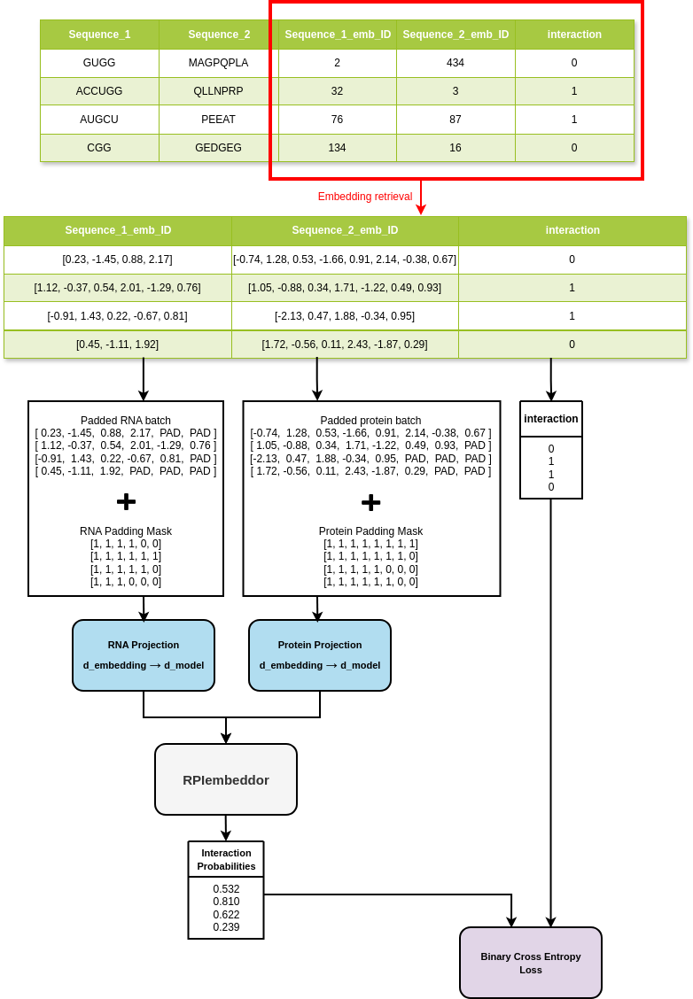
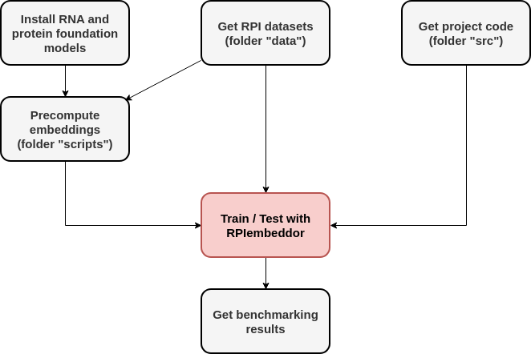
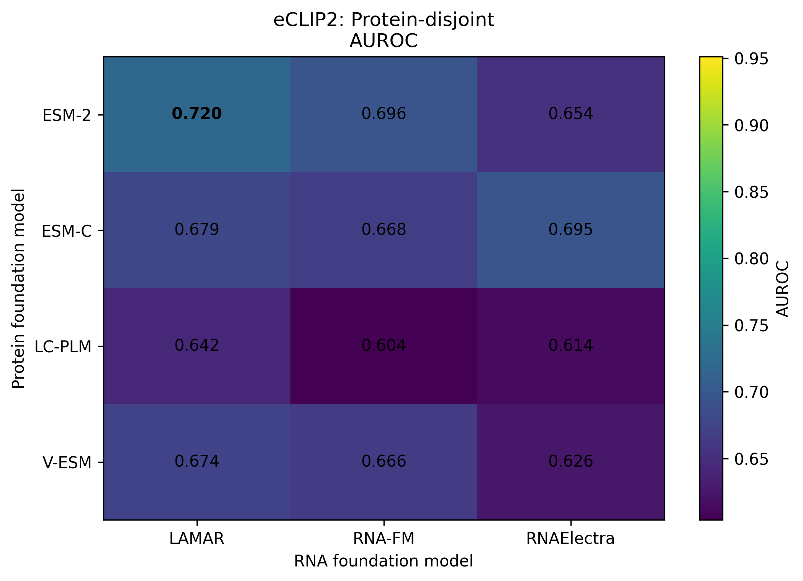
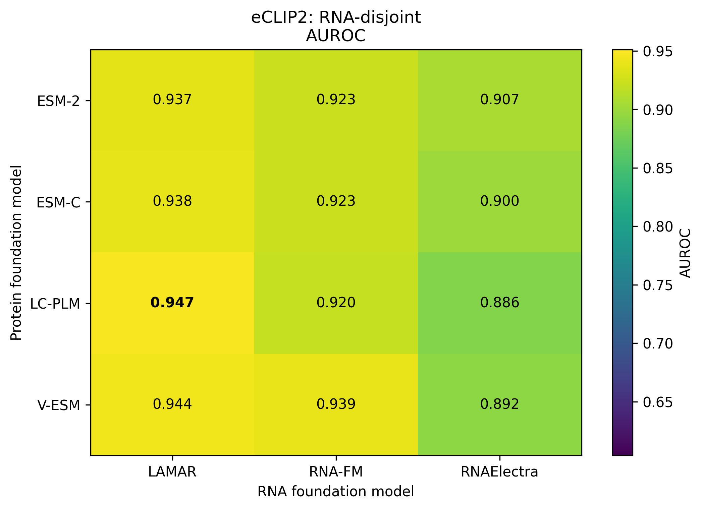
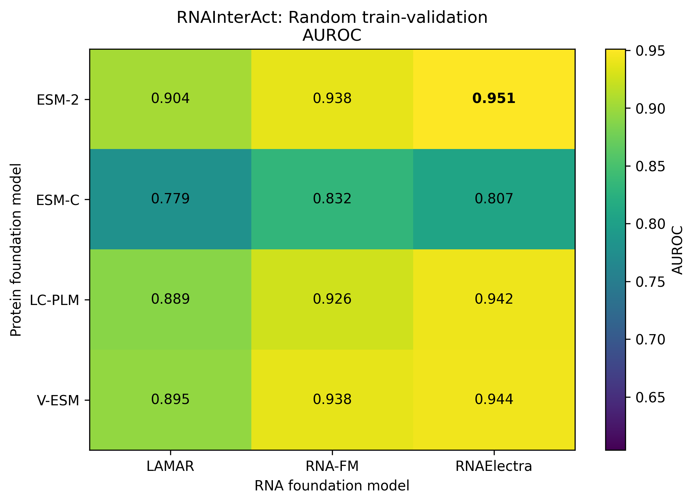
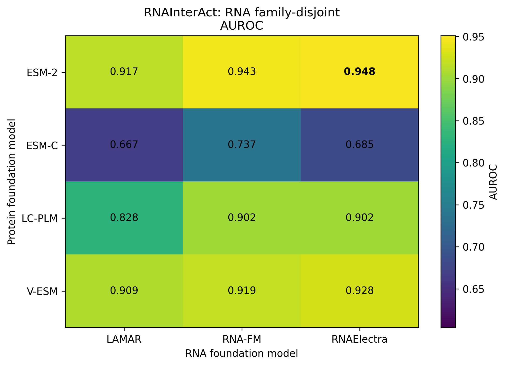

# RPIEmbeddor 2.0

This is not a new version but an extension and benchmarking of **RPIembeddor**, a transformer-based model for RNA–protein interaction (RPI) prediction from frozen RNA and protein foundation-model embeddings.

RPIembeddor was originally developed by [Matus, Dominika; Runge, Frederic; Franke, Jörg K. H.; Gerne, Lars; Uhl, Michael; Hutter, Frank and Backofen, Rolf; from the Machine Learning Lab and the Bioinformatics group of the University of Freiburg, in the paper "RNA-Protein Interaction Classification via Sequence Embeddings"](https://www.biorxiv.org/content/10.1101/2024.11.08.622607v1). 


This repository contains the code used in my Master's thesis at the University of Freiburg:

> **Evaluating foundation model embeddings in RNA-Protein Interaction classification with RPIembeddor**

RPIembeddor takes a pretrained embedding of one RNA sequence and one protein sequence (kept frozen), passes them through a transformer module, and outputs the probability that the two interact.



*Figure 1. Overview of RPIembeddor: frozen RNA and protein embeddings are fed to a transformer module that outputs an interaction probability.*

## What this work adds

- Reproduction of the original RPIembeddor results on RNAInterAct.
- Evaluation on an eCLIP-based dataset (1.47M balanced RNA–protein pairs, 151-nt RNAs, 173 proteins) [constructed within the group by Dr. Michael Uhl].
- Benchmark of 12 protein × RNA foundation-model combinations (protein: ESM-2, ESM-C, LC-PLM, V-ESM; RNA: RNA-FM, LAMAR, RNAElectra) under identical training settings, across 2 datasets, 2 data splits and 3 seeds.
- Baselines (logistic regression, MLP, CNN) and a one-hot-encoding ablation.

## Reproduction of this work
In order to reproduce the results in reasonable time, one would have to count with GPU resources. This work was done thanks to the HPC computing resources of "bwUniCluster3.0" and "bwForCluster Helix" of Baden-Württemberg, Germany.

The main steps necessary to reproduce this work are the following:




### Installation of original RNA and protein foundation model

As an example on how to install a pair of foundation models, in fact the original pair from the paper of RPIembeddor, miniconda is recommended as follows: 

Create the environment:

```bash
conda create -n rpi python=3.8 pip
conda activate rpi
pip install -r requirements.txt
```

Install ESM-2:

```bash
pip install git+https://github.com/facebookresearch/esm.git
```

Install RNA-FM:

```bash
pip install rna-fm

```

## Requirements

The required Python packages are listed in `requirements.txt`. Note that this file contain the whole set o f packages used throughout the elaboration of the thesis, including all the foundation models dependencies. 

## Main findings

- The best foundation-model combination changed with dataset and split; some combinations outperformed the original ESM-2 + RNA-FM setup by roughly 0.02–0.03 AUROC/AUPR, but none won in every setting.
- Unsupervised embedding-quality metrics were only partially predictive of downstream performance.
- Replacing embeddings with one-hot encodings clearly reduced performance.






*Figures. Mean AUROC performances over 3 seeds on the 4 different data settings (2 different datasets and 2 different splits for each of them)*

## Repository Structure

```text
.
├── src/                        Model architecture, training and inference
├── baselines/                  Logistic Regression, CNN and MLP baselines
├── scripts/
│   └── embedding_generation/   Embedding generation utilities
├── figures/
├── data/
└── requirements.txt
```

## Citation

If you use this repository, please cite the accompanying Master's thesis and the original RPIembeddor paper:
https://www.biorxiv.org/content/10.1101/2024.11.08.622607v1

